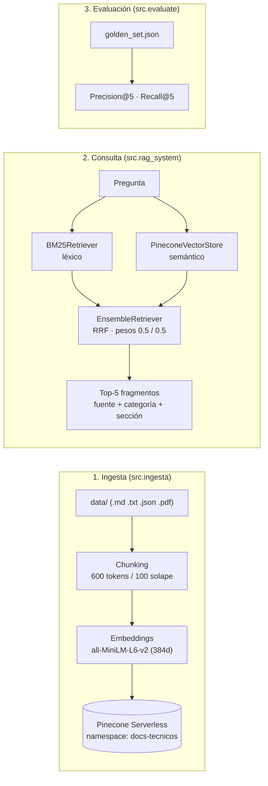

# 🧠 Pre-entrega 4 — Sistema RAG escalable en la nube con Pinecone

Módulo de **Recuperación Escalable** en Python: un pipeline completo de RAG en la nube que carga documentos técnicos, los indexa en **Pinecone Serverless** con metadata avanzada y los consulta con un **recuperador híbrido (BM25 + búsqueda vectorial)**. Incluye un script de evaluación (`evaluate.py`) que mide **Precision@k** y **Recall@k** sobre un *Golden Set* de preguntas.

## Stack

| Rol | Tecnología |
|-----|------------|
| Orquestación | LangChain — `EnsembleRetriever`, `BM25Retriever`, `PineconeVectorStore` |
| Base vectorial | **Pinecone Serverless** (aws / us-east-1, métrica cosine) |
| Embeddings | `sentence-transformers/all-MiniLM-L6-v2` local (384 dims, gratis) u OpenAI `text-embedding-3-small` (1536 dims) |
| Búsqueda léxica | **BM25** (`rank_bm25`) |
| Chunking | `RecursiveCharacterTextSplitter` — 600 tokens con 100 de solape |
| Evaluación | **Precision@k · Recall@k** sobre `evaluation/golden_set.json` |

## 📐 Arquitectura



## 📁 Estructura del repositorio

```
.
├── data/                              # Dataset técnico (Markdown, 3 categorías)
│   ├── bibliotecas/                   # requests.md · pathlib.md · pandas.md
│   ├── lenguaje/                      # manejo_de_excepciones.md · type_hints.md
│   └── web_y_async/                   # asyncio.md · fastapi.md
├── evaluation/
│   ├── golden_set.json                # Banco de 7 preguntas + documento esperado
│   └── resultados.json                # Se genera al correr la evaluación
├── src/
│   ├── config.py                      # Configuración central (.env) — una sola fuente de verdad
│   ├── embeddings.py                  # Fábrica de embeddings (HuggingFace local u OpenAI)
│   ├── setup_pinecone.py              # 1) Crea/verifica el índice Serverless
│   ├── ingesta.py                     # 2) Carga → chunking → metadata → upsert a Pinecone
│   ├── rag_system.py                  # 3) Clase RAGSystem + EnsembleRetriever (BM25 + vectorial)
│   ├── metricas.py                    # Funciones puras de Precision@k / Recall@k
│   ├── evaluate.py                    # 4) Script de evaluación + reporte en consola
│   ├── consulta.py                    # CLI para consultar el recuperador
│   └── pipeline.py                    # Orquestador: setup → ingesta → evaluación
├── tests/
│   └── test_metricas.py               # Tests de las métricas (sin red ni API keys)
├── .env.example                       # Plantilla de variables de entorno
├── requirements.txt                   # Dependencias
└── README.md
```

## ✅ Requisitos

- **Python 3.10+** (probado en 3.14)
- Cuenta **gratuita** de Pinecone → API key en [app.pinecone.io](https://app.pinecone.io) → *API Keys*
- Conexión a internet solo la primera vez (descarga el modelo de embeddings, ~90 MB)
- *(Opcional)* API key de OpenAI, únicamente si prefieres `text-embedding-3-small`

> 💡 No necesitas GPU ni tarjeta de crédito: el modelo de embeddings corre en CPU y el plan gratuito de Pinecone alcanza de sobra para este proyecto.

## 🚀 Puesta en marcha

### 1) Entorno virtual e instalación

Windows (PowerShell):
```powershell
python -m venv .venv
.\.venv\Scripts\Activate.ps1
pip install -r requirements.txt
```

macOS / Linux:
```bash
python3 -m venv .venv
source .venv/bin/activate
pip install -r requirements.txt
```

> 💡 Si PowerShell bloquea la activación: `Set-ExecutionPolicy -Scope CurrentUser RemoteSigned` (una vez) o usa CMD con `.\.venv\Scripts\activate.bat`.
> 💡 Si el proyecto vive dentro de OneDrive, considera crear el `.venv` **fuera** de OneDrive (ej: `C:\venvs\pe4`) para evitar sincronizar miles de archivos de librerías.

### 2) Configurar el archivo `.env`

```powershell
Copy-Item .env.example .env    # macOS/Linux: cp .env.example .env
```

Edita `.env` y pega tu clave real (el archivo está en `.gitignore`, **nunca se sube**):

| Variable | ¿Obligatoria? | Valor por defecto | Descripción |
|----------|---------------|-------------------|-------------|
| `PINECONE_API_KEY` | ✅ Sí | — | API key gratuita de Pinecone |
| `INDEX_NAME` | No | `rag-tecnico-python` | Nombre del índice Serverless |
| `NAMESPACE` | No | `docs-tecnicos` | Namespace del índice (ingesta + búsqueda) |
| `EMBEDDING_PROVIDER` | No | `huggingface` | `huggingface` (local, 384 dims) u `openai` (1536 dims) |
| `OPENAI_API_KEY` | Solo con OpenAI | — | Requerida únicamente si `EMBEDDING_PROVIDER=openai` |
| `CHUNK_SIZE` / `CHUNK_OVERLAP` | No | `600` / `100` | Tamaño de chunk en tokens y solape |
| `TOP_K` | No | `5` | Cantidad de documentos a recuperar |
| `PESO_BM25` / `PESO_VECTORIAL` | No | `0.5` / `0.5` | Pesos del `EnsembleRetriever` |

### 3) Crear el índice en Pinecone (Serverless)

```bash
python -m src.setup_pinecone
```

Verifica si el índice existe y:
- Si **no existe**, lo crea con la dimensión exacta del modelo de embeddings (métrica cosine, Serverless).
- Si **existe**, compara dimensiones: si no coinciden con el modelo configurado, se detiene con un mensaje claro (así nunca subes vectores de 384 dims a un índice de 1536).

### 4) Ingesta de documentos

```bash
python -m src.ingesta             # carga data/ y sube a Pinecone
python -m src.ingesta --recrear   # además vacía el namespace antes de subir
```

Qué hace: carga los documentos de `data/` → los fragmenta en chunks de 600 tokens (100 de solape) → genera embeddings → los sube con **metadata avanzada** e **IDs deterministas** (repetir la ingesta actualiza, no duplica).

### 5) Probar el recuperador híbrido

```bash
python -m src.consulta                                    # modo interactivo
python -m src.consulta --pregunta "¿Qué hace raise_for_status?"
```

### 6) Evaluación (Precision@k / Recall@k)

```bash
python -m src.evaluate
```

Imprime el reporte completo en consola y guarda el resumen en `evaluation/resultados.json`.

### 🔁 Replicar el índice desde cero (resumen)

```bash
git clone <url-de-tu-repo>
cd <tu-repo>
pip install -r requirements.txt
# 1) pega tu PINECONE_API_KEY en .env
python -m src.setup_pinecone   # 2) crea el índice serverless
python -m src.ingesta          # 3) indexa el dataset
python -m src.evaluate         # 4) valida con el Golden Set
```

Como los IDs de cada vector son deterministas (`fuente-chunk_id`), cualquiera que replique estos pasos obtiene exactamente el mismo índice.

### Atajo: pipeline completo

```bash
python -m src.pipeline --recrear   # setup + ingesta + evaluación en un solo comando
```

## 🗂️ Dataset incluido

Documentos técnicos en Markdown (contenido original redactado para este proyecto), organizados en 3 categorías:

| Archivo | Categoría | Contenido |
|---------|-----------|-----------|
| `requests.md` | bibliotecas | HTTP con `requests`: timeouts, `raise_for_status()`, sesiones, streaming |
| `pathlib.md` | bibliotecas | Rutas como objetos: `read_text()`, `glob()`, `rglob()`, creación de directorios |
| `pandas.md` | bibliotecas | `DataFrame`, filtros, `groupby`, `merge`, nulos, Parquet |
| `asyncio.md` | web_y_async | Corrutinas, `gather`, `create_task`, semáforos y timeouts |
| `fastapi.md` | web_y_async | Endpoints, validación con Pydantic, `APIRouter`, `Depends` |
| `manejo_de_excepciones.md` | lenguaje | `try/except/else/finally`, `raise from`, excepciones propias |
| `type_hints.md` | lenguaje | Anotaciones, `Optional`, `TypedDict`, `Protocol`, mypy |

También puedes agregar tus propios archivos `.md`, `.txt`, `.json` (lista de objetos con clave `contenido`) o `.pdf` a `data/` y volver a ingerir.

## 🧬 Esquema de la metadata (dentro del vector)

El texto de cada chunk viaja **dentro de Pinecone** (`text`), así una sola consulta trae vector + contenido + fuente, sin depender de una base de datos relacional aparte:

| Clave | Tipo | Ejemplo | Descripción |
|-------|------|---------|-------------|
| `text` | str | `"## Manejo de errores..."` | Contenido íntegro del chunk |
| `fuente` | str | `requests.md` | Archivo de origen |
| `categoria` | str | `bibliotecas` | Etiqueta de categoría (carpeta del dataset) |
| `etiquetas` | list[str] | `["bibliotecas", "requests"]` | Etiquetas filtrables |
| `seccion` | str | `Manejo de errores con raise_for_status` | Último título detectado en el chunk |
| `pagina` | int | `3` | Número de página (solo PDFs) |
| `chunk_id` | int | `7` | Posición del chunk dentro del corpus |

## 🔀 ¿Cómo funciona el recuperador híbrido?

- **BM25 (léxico):** encuentra coincidencias exactas de palabras. Brilla con siglas, nombres propios e identificadores: `raise_for_status`, `Pydantic`, `else/finally`, `read_text`.
- **Vectorial (semántico):** entiende paráfrasis y sinónimos ("¿cuánto descanso me corresponde?" ≈ "vacaciones"), aunque puede fallar con términos exactos poco frecuentes.
- **`EnsembleRetriever`:** combina ambos rankings con *Reciprocal Rank Fusion* y pesos `[0.5, 0.5]` (configurables con `PESO_BM25` / `PESO_VECTORIAL` en el `.env`).

💡 **Para experimentar:** prueba `PESO_BM25=0.7` / `PESO_VECTORIAL=0.3` y vuelve a correr `python -m src.evaluate`. Vas a ver moverse el orden de los resultados según el tipo de pregunta.

## 📊 Evaluación (Golden Set)

El Golden Set (`evaluation/golden_set.json`) define pares pregunta → documento esperado, con 7 preguntas que mezclan términos exactos y paráfrasis:

```json
[
  {
    "pregunta": "¿Qué hace raise_for_status() en requests y qué excepción lanza ante un error 4xx o 5xx?",
    "documento_id_esperado": "requests.md"
  }
]
```

Métricas calculadas por `evaluate.py` (con `k = 5` por defecto):

- **Recall@5:** ¿está el documento correcto entre los 5 recuperados? → 1.0 o 0.0 por pregunta.
- **Precision@5:** ¿qué fracción de los 5 recuperados pertenece al documento esperado?
- **Recall@5 (chunks)** *(métrica complementaria)*: ¿qué fracción de los chunks de ese documento alcanzó el top-5?

> 📌 Nota: como el Golden Set tiene **un solo documento esperado por pregunta**, el Recall@5 por documento solo puede dar 0% o 100% (no hay término medio matemáticamente posible). El Recall por chunks muestra el matiz intermedio.

Ejemplo de salida en consola (ilustrativo; tus números pueden variar):

```text
================================================================================
EVALUACION DEL RECUPERADOR HIBRIDO (BM25 + Pinecone)
Indice: rag-tecnico-python | Namespace: docs-tecnicos | Embeddings: sentence-transformers/all-MiniLM-L6-v2 (384 dims)
k = 5 | Preguntas del Golden Set: 7 | Chunks en el corpus: 16
================================================================================
[OK] (1/7) ¿Qué hace raise_for_status() en requests y qué excepción lanza ante un error 4xx o 5xx?
        esperado:    requests.md
        recuperados: requests.md, requests.md, pandas.md, pathlib.md, asyncio.md
        Recall@5: 100% | Precision@5: 40.0% | Recall chunks@5: 100.0%
...
--------------------------------------------------------------------------------
RESULTADOS PROMEDIOS
  Recall@5 (documento):  100.0%
  Precision@5:           35.0%
  Recall@5 (chunks):     90.0%
```

## 📈 Resultados de la evaluación

> ⚠️ **Completa esta tabla** después de correr `python -m src.evaluate` en tu cuenta. El detalle completo queda en `evaluation/resultados.json`.

| Métrica | Valor |
|---------|-------|
| Preguntas evaluadas | 7 |
| Recall@5 promedio (documento) | _pendiente_ |
| Precision@5 promedio | _pendiente_ |
| Recall@5 promedio (chunks) | _pendiente_ |

## 🧯 Errores comunes que este proyecto evita

- **Mismatch de dimensiones:** la dimensión nunca se escribe a mano. `src/config.py` la deriva del modelo de embeddings y `src/setup_pinecone.py` valida la del índice existente antes de permitir una ingesta.
- **Ignorar el namespace:** `NAMESPACE` viaja desde la ingesta hasta la búsqueda vectorial y la evaluación; cambiar de dataset es cambiar de namespace, sin ruido entre conjuntos de datos.
- **Subestimar el chunking:** 600 tokens con 100 de solape (rango sugerido 500–800), configurable en el `.env`. Cada chunk guarda además su `seccion` para no perder contexto.

## ☁️ Notas de escalabilidad

- **Serverless:** el índice de Pinecone escala solo; no administras servidores ni capacidad.
- **Multi-inquilino:** un `NAMESPACE` por cliente o tipo de dato mantiene las búsquedas aisladas y rápidas (solo cambias la variable de entorno).
- **Filtros por metadata:** la clave `etiquetas` permite filtrar búsquedas por categoría o tema directamente en Pinecone.
- **Idempotencia:** IDs deterministas + `--recrear` hacen que reindexar sea seguro y repetible.
- **Costo controlado:** embeddings locales gratis por defecto; si usas OpenAI, `text-embedding-3-small` cuesta ~$0.02 por millón de tokens (este dataset son centésimas de centavo).

## 🐙 Publicar en GitHub

```bash
git init -b main
git add .
git commit -m "Pre-entrega 4: módulo de recuperación escalable con Pinecone"
git remote add origin https://github.com/<tu-usuario>/<tu-repo>.git
git push -u origin main
```

Antes de subir, verifica que `.env` **no** aparezca en `git status` (debe estar ignorado).

## 🔭 Próximos pasos (opcionales)

- Reranking con un cross-encoder (`sentence-transformers/CrossEncoder`) sobre el top-5.
- Generación de respuestas con un LLM usando los fragmentos recuperados como contexto (RAG completo).
- Filtro por `categoria` en `src.consulta` usando metadata filtering de Pinecone.
- Evaluación con métricas adicionales (MRR, nDCG) o frameworks como RAGAS.

## Notas

- El notebook de clases queda fuera de este repositorio a propósito; todo el flujo está en `src/`.
- Los tests de métricas se ejecutan sin red ni API keys: `python tests/test_metricas.py`.
